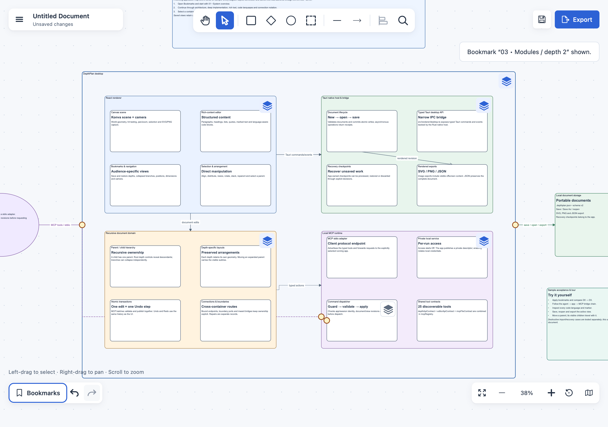

# DepthPlan

DepthPlan is a desktop diagram editor from TwistedPears. Keep a system overview,
nested components, connections, rich text and code in one board. Show or hide
children and bookmark useful views; group related boards in a project.

**The application is in development and has not been released.** Platform support,
installed-candidate acceptance, signing and security/support decisions remain
[release requirements](docs/release.md).

[Try it](docs/preview.md) · [Open the sample tour](docs/sample/depthplan_application_tour.depthplan) · [Give feedback](https://github.com/TwistedPears/depthplan-diagram/issues/new/choose)



The application tour with nested components revealed in a macOS development build.
Use bookmarks to move between the system overview and deeper detail on the same board.

There is no downloadable preview yet. You can [build from source](#build-and-run)
or follow the [tester guide](docs/preview.md) for availability, a short exercise
and current limitations.

## About the Project

DepthPlan was created and is primarily developed and maintained
by John Sanford (@drofnas) under the TwistedPears organization.

## Build and run

Use Node.js 24, npm 10+, Rust 1.94.1 and the
[Tauri native prerequisites](https://v2.tauri.app/start/prerequisites/).
From a checkout:

```sh
cargo install cargo-about --version 0.9.2 --locked --features cli
npm ci
npm run dev
```

`npm run build` creates ordinary release executables; `npm run package` creates
host-native installers without publishing. See [development](docs/development.md)
for toolchains, validation, dependency audits, licenses and capacity commands.
The app and bundled MCP adapter need no global Node installation when distributed.

Local artifacts are unsigned unless signing is configured. They are development
builds, not approved public releases. Updates currently require manual installation;
there is no automatic update check, download or install-on-quit behavior.

## Work with nested diagrams

Child controls show or hide individual branches on the same canvas. Ordinary
collapse remembers which descendants were open; Ctrl+click collapses them all.

Opening children auto-arranges overlapping content, grows parents and pushes
colliding neighbors aside with a short animation. Closing restores the relevant
arrangement. Manual edits are remembered per state and saved with the document;
unrelated objects keep their current geometry. Direct drag/resize remains manual.
Text, styles and ownership remain shared across views. Moving a parent carries
its children. Numeric depths and retained layouts remain part of the technical
file/automation contract.

Scroll to zoom around the pointer. Right-drag, or use the Hand tool, to pan.
Search includes hidden objects; choosing a result reveals its path. Copy/paste
with Ctrl/Cmd+C and Ctrl/Cmd+V duplicates selected diagram content down/right;
text editors retain normal text clipboard behavior.

Bookmarks capture child disclosure, positions/sizes and camera focus. Applying one
is undoable and preserves current object content/style/ownership. Reset View
replaces its saved view; ordinary pan/zoom does not change it or dirty the document.

Save preserves the complete current-format document and inactive layouts. New,
Open, Reload and recovery Restore start new undo sessions; Save keeps history.
Autosave is On by default for saved boards and can be changed in Settings.
Unsaved-work guards and external-file conflict checks prevent silent replacement.
Recovery checkpoints accepted edits separately from source files; recent changes
and unfinished drafts can be lost, so keep separate backups.

Whole/selection exports include revealed offscreen content and appropriate
connections, with no editor controls or hidden descendants. Large PNG output uses
tiled streaming; practical limits still depend on memory/disk/time. The
[document and editing reference](docs/document-and-editing.md) defines format,
containment, connections, rich content, bookmarks, persistence and export details.

## Work with projects

A project groups independent boards in a folder, like files in a VS Code project.
Open its `.depthproject` manifest and use the Project drawer to switch boards.
Each `.depthplan` file keeps its own content and bookmarks. Search across boards,
link objects to boards or bookmarks, and return to the previous view.

Create, import, duplicate and rename boards without combining their contents.
Share the complete project folder; the manifest contains membership, not the
boards themselves. See [Projects](docs/projects.md) for saving, navigation and
the [manifest schema](docs/projects.md#project-file-schema).

## Local automation

Enable **Menu → MCP Server**, then open **MCP Details** for the executable,
descriptor and client configuration. The tools edit the same live boards as
the UI. Access starts Off each launch; disk operations require explicit local
folder approval. See [MCP setup and tools](docs/mcp.md).

## AI architecture skills

Use the [installable skills](skills/README.md) to
[audit a codebase](skills/depthplan-audit/SKILL.md),
[build or refresh a navigable architecture map](skills/depthplan-map/SKILL.md), and
[find where a code change belongs](skills/depthplan-locate/SKILL.md).
They cover source evidence, database views and Rails conventions, with separate
audit review and read-only placement workflows. See the
[worked examples](skills/examples/README.md) for setup and usage.

## Documentation

- [Templates](docs/templates.md): an example gallery, insertion on the current board, and portable sharing.

| Guide                                                | Contents                                                     |
| ---------------------------------------------------- | ------------------------------------------------------------ |
| [Try DepthPlan](docs/preview.md)                     | Preview availability, first steps, limitations and feedback  |
| [Contributing](CONTRIBUTING.md)                      | Reporting problems and making small code changes             |
| [Product requirements](docs/PRD.md)                  | Audience, workflows, feature scope and non-goals             |
| [Product decisions](docs/product-decisions.md)       | Retained, deferred and dropped scope with decision rationale |
| [Architecture](docs/architecture.md)                 | Native/renderer ownership, rendering and trust boundaries    |
| [Projects](docs/projects.md)                         | Multi-board workspaces, manifest schema and folder sharing   |
| [Document and editing](docs/document-and-editing.md) | Current file format and precise editor behavior              |
| [MCP](docs/mcp.md)                                   | Client setup, tools, permissions and retries                 |
| [Development](docs/development.md)                   | Build, test, audit, license and performance procedures       |
| [Release](docs/release.md)                           | Candidate acceptance, unresolved risks and owner decisions   |
| [Icons](docs/design/icons.md)                        | Artwork, prompt collections and integration                  |
| [Samples](docs/sample/README.md)                     | Editable examples and expected behavior                      |
| [Security status](SECURITY.md)                       | Current boundaries and pending reporting policy              |

## License

DepthPlan uses the Business Source License 1.1; see [LICENSE](LICENSE) and the
non-binding [commercial terms summary](COMMERCIAL-TERMS.md). Personal, educational,
non-profit, and internal business use are free of charge. White-labeling,
commercial redistribution, hosted services, and embedding DepthPlan in a commercial
product distributed to third parties require a separate commercial license.

This version converts to Apache License 2.0 on January 1, 2030, or the fourth
anniversary of its first public distribution under this license, whichever comes
first. Until that conversion, this is source-available software, not an open-source
license. Third-party components retain their own licenses; see
[THIRD-PARTY-NOTICES.md](THIRD-PARTY-NOTICES.md).
